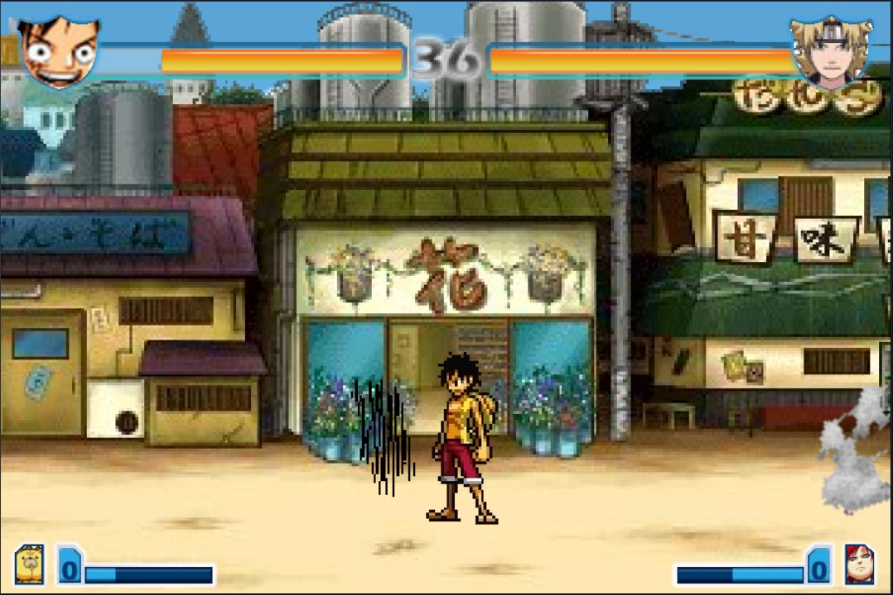
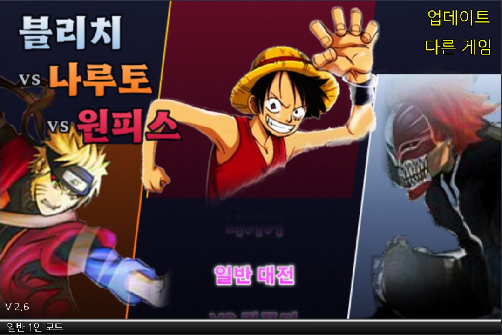
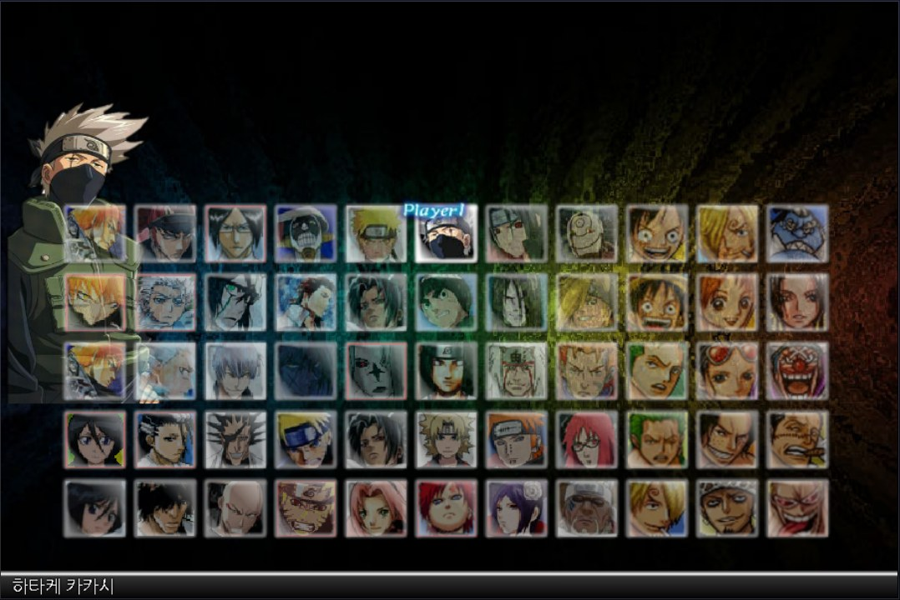

# 블리치 VS 나루토 VS 원피스 — 개발 저장소

[](https://kjh082427.github.io/Naruto-vs-Bleach/)

▶ **바로 플레이: https://kjh082427.github.io/Naruto-vs-Bleach/** (위 사진을 클릭해도 됩니다)

플래시 게임 *Bleach vs Naruto*(5DPlay 원작 2.6판, ActionScript 2)을 분석해 한글화하고, *원피스 vs 페어리테일 1.1*의 원피스 캐릭터 15명을 이식하고 새 캐릭터(쥬라큘 미호크, 샹크스)를 만든 모딩 프로젝트입니다. 브라우저에서는 [Ruffle](https://ruffle.rs/)로 실행됩니다.

- 현재 버전: **1.1** (`VERSION` 파일 — 게임 타이틀·업데이트 내용·웹페이지·스플래시가 모두 이 값을 씀. 캐릭터 추가/업데이트를 main에 커밋할 때 올림)

- 57인: 블리치 18 · 나루토 22 · 원피스 17 (원피스 15명 이식 + 직접 만든 쥬라큘 미호크·샹크스)
- 일반 대전의 상대는 매 판 랜덤 (선택 가능한 57인 중, 라이벌·보스는 후반 스테이지)
- 타이틀/첫 화면/웹 페이지는 이치고·나루토·루피 3인 구도로 새로 디자인

| 타이틀 | 캐릭터 선택 |
|---|---|
|  |  |

## 브랜치

| 브랜치 | 용도 |
|---|---|
| `main` (여기) | 개발용. 원본, 분석 자료, 빌드 도구, 디자인 소스, 빌드 결과 `dist/` |
| `play-game` | 실행 전용. `dist/` 내용만 들어 있고 GitHub Pages로 서비스됨 (위 플레이 주소) |

## 폴더 구조

| 경로 | 내용 |
|---|---|
| `game/` | 원본 게임 복원본 (빌드 입력, 수정하지 않음): `game.swf`, `fighter/`, `fighter/fz/`(보조), `music/` |
| `source/` | 내려받은 원본: `blog-kakao/`, `waflash-dmc/`(DMC 변조본), `onepiece/`(원피스 vs 페어리테일 1.1) |
| `analysis/` | FFDec로 추출한 AS2 스크립트·태그 덤프 (`analysis/game/`, 캐릭터별, `analysis/op/` 원피스) |
| `tools/build.py` | **빌드 스크립트** — `game/` + 번역/디자인/원피스 데이터 → `dist/` |
| `tools/op_assets.py` | 원피스 아이콘·초상·필살기 컷인·로딩 배너 PNG 생성 (`work/op/ui/`) |
| `tools/fighter_builder.py` | 새 캐릭터 조립 공용 모듈 (프레임 구간 복사·이어 붙이기, 이펙트 오버레이, 히트박스 이름 변경, 2배 해상도 스프라이트, gjl 공격력) |
| `tools/mihawk.py` | 쥬라큘 미호크 SWF 생성 (이치고 만해 폼 리스킨 + 기술 재조립, `work/mihawk/`) |
| `tools/shanks.py` | 샹크스 SWF 생성 (켄파치 리스킨 + 기술 재조립·카무사리, `fighter_builder` 사용, `work/shanks/`) |
| `tools/label_map.py`, `shapecolor.py` | 캐릭터 라벨→비트맵/히트박스 지도, 벡터 도형 색 조사·변경 |
| `tools/swfpatch.py`, `swftext.py` | SWF 태그 편집 라이브러리 (바이트 단위 편집, 텍스트→기기 폰트, 비트맵 도형) |
| `tools/swfnames.py`, `swfdisplay.py`, `swfbounds.py` | SWF 조사 도구 (인스턴스 이름/라벨, 프레임별 표시 목록, 좌표 범위) |
| `tools/undmc.py` | waflash DMC 변조 SWF 복원 |
| `tools/ffdec/` | JPEXS FFDec 26.4.0 (디컴파일·스크립트 재삽입·이미지 교체) |
| `tools/serve.sh` | 로컬 서버 `http://127.0.0.1:8765/` (`dist/`) |
| `tools/test/autoplay.html` | 실행 검증용 자동 입력 페이지 (키를 일정 시간 누름; `dist/`에 임시 복사해서 사용, 배포 안 함) |
| `web/` | 웹 페이지 템플릿 (`index.html`, 폰트) — 빌드 때 `dist/`로 복사 |
| `work/l10n/` | 번역 데이터 (`game_strings.json` 스크립트 문자열, `game_texts.json` 텍스트 태그) |
| `work/design/` | UI 비트맵 렌더러: `render_ui.py`(메뉴 라벨), `render_v3.py`(타이틀·스플래시), `render_web.py`(웹 폰트 서브셋), 결과 `out/` |
| `work/op/` | 원피스 이식 데이터: `roster.json`(id·한글 이름·대사·음악·컷인), `ui/`, `art/` |
| `work/mihawk/` | 미호크: `fighter.json`(등록 정보), `render_sprites.py`→`sprites/`(리스킨·흑도 요루), `render_ui.py`→`ui/`, 참고 자료 |
| `work/shanks/` | 샹크스: `fighter.json`, `render_sprites.py`→`sprites/`(2배 해상도 리스킨, scipy 필요), `render_fx.py`→`fx/`(카무사리·패왕색 등 이펙트), `render_ui.py`→`ui/` |
| `Dracule Mihawk/`, ` Shanks/` | 사용자가 준 참고 자료(설명·일러스트·모델링 사진). 영상(`*.mp4`)과 거기서 뽑은 `work/*/ref/`는 용량 때문에 저장소에 없음 |
| `work/build/`, `work/shots/` | 빌드 중간 산출물, 검증 스크린샷 |
| `dist/` | 빌드 결과 (= `play-game` 브랜치 내용) |
| `ANALYSIS.md` | **분석 문서** — 엔진 구조, 캐릭터 등록, 템플릿, 성능, 원피스 이식(§8), 미호크(§9), 샹크스(§10) |

## 개발 환경

- Python 3 + 가상환경: `python3 -m venv tools/venv && tools/venv/bin/pip install pillow numpy scipy fonttools`
- Java 17 이상 (FFDec 실행용, `tools/ffdec/ffdec.jar` 포함)
- (선택) 실행 검증용 headless Chrome: `tools/chrome-headless-shell-linux64/`는 용량 때문에 저장소에 없음 — [Chrome for Testing](https://googlechromelabs.github.io/chrome-for-testing/)에서 `chrome-headless-shell-linux64`를 받아 그 경로에 풀면 `tools/chrome-wrapper.sh`로 실행됨

## 빌드와 실행

```sh
tools/venv/bin/python tools/build.py   # game/ → dist/ (약 1~2분)
tools/serve.sh                         # http://127.0.0.1:8765/
```

빌드는 `dist.new/`에 만든 뒤 `dist/`와 한 번에 바꿔치기하므로, 켜져 있는 서버는 재시작할 필요가 없습니다(빌드 중에도 게임이 끊기지 않음).

빌드 단계 (`tools/build.py`):
1. `game/` → `dist/` 복사, `web/` 페이지와 Ruffle 설정(`tools/ruffle_config.json`) 삽입
2. `game.swf` 텍스트 한글화, 스플래시·타이틀 교체 (`work/design/out/`)
3. 원피스 캐릭터: 아이콘/초상/컷인 프레임 추가, 선택 화면 12×5 재배치, 캐릭터 SWF 피격 판정 패치 → `dist/fighter/op/`
   새 캐릭터(`CUSTOM_FIGHTERS`: 미호크·샹크스): UI 추가 후 `tools/<이름>.py`로 SWF 생성 → `dist/fighter/op/`
4. FFDec로 UI 비트맵 교체, 번역·확장된 스크립트(등록부·엔진 함수) 재삽입

## 자주 하는 작업

- **번역 수정**: `work/l10n/*.json` 수정 → 빌드
- **타이틀/스플래시 디자인**: `tools/venv/bin/python work/design/render_v3.py` → 빌드
- **원피스 캐릭터 이름·대사·음악**: `work/op/roster.json` 수정 → 빌드 (아이콘/컷인을 바꿨다면 먼저 `tools/venv/bin/python tools/op_assets.py`)
- **새 캐릭터 추가**: 준비할 파일은 [`docs/CHARACTER_REQUEST.md`](docs/CHARACTER_REQUEST.md). 같은 5DPlay 엔진 캐릭터 이식은 `ANALYSIS.md` §8(`work/op/roster.json`), 새 캐릭터 제작(리스킨 + 기술 재조립)은 §9·§10(`tools/fighter_builder.py`, 예시 `tools/shanks.py`) 참고
- **테스트용 시작 커서**: `BVN_SELECT_P1=路飞 tools/venv/bin/python tools/build.py` (선택 화면에서 1P 커서가 해당 캐릭터에서 시작)

## 배포 (`play-game` 갱신)

```sh
tools/venv/bin/python tools/build.py
git worktree add /tmp/play-game play-game
rsync -a --delete --exclude .git --exclude README.md --exclude .nojekyll dist/ /tmp/play-game/
cd /tmp/play-game && git add -A && git commit -m "Update playable build" && git push
cd - && git worktree remove /tmp/play-game
```

GitHub Pages가 `play-game` 브랜치 루트를 서비스하므로 1~2분 뒤 플레이 주소에 반영됩니다.

## 저작권

개인 학습·모딩 목적의 팬 프로젝트입니다. 게임 원작은 5DPlay/4399, 원피스 캐릭터 SWF는 *원피스 vs 페어리테일 1.1* 제작자, 캐릭터와 작품의 권리는 각 원작자(BLEACH, NARUTO, ONE PIECE)에게 있습니다. 폰트는 SIL Open Font License(나눔고딕, Gothic A1, Hahmlet)를 따릅니다.
